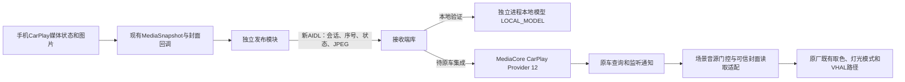

# MediaCore双端发布桥：本地验证版

用户在2026-11-02确认“先做双端本地方案，暂不部署原车”。开发基线为71版提交`8a49e0d`。

本目录是独立验证宿主，不是原车MediaCore的替代包。没有在DiPlay主应用注册桥接模块，没有部署到车机，也没有更改原车服务、设置或灯光。它只能验证我们新增的发布协议、接收状态和封面访问。原车集成仍有明确的代码接点，见下文。

## 数据链路



最后两条原厂路径没有在本轮部署或验收。链路不传PCM、FFT或伪造节拍；元数据更新不等于物理音乐律动已经成立。实际节拍采样器是否消费当前CarPlay输出，仍需实车取证。音频路由、音量、焦点和方向盘按键沿用71版，不经过本桥。

## 四个模块

| 模块 | 作用 |
|---|---|
| `mediacore-bridge-contract` | 新AIDL与受限Bundle协议；不是猜测原车Binder事务号 |
| `mediacore-bridge-publisher` | 复用通用媒体回调，显式绑定接收组件，后台压缩并转发图片；生产App尚未依赖它 |
| `mediacore-bridge-receiver` | 身份核验、会话租约、状态/封面存储、原厂模型转换、OEM服务基类及场景适配辅助方法 |
| `mediacore-bridge-lab` | 合成曲目发布界面，接收服务运行在`:receiver`进程，只回读本地模型 |

仅`settings.gradle.kts`增加独立项目入口。`common`、`shared`、`mobile`、音频模块与仪表模块均没有新增接线，71版的发布APK和版本号不变。

## 状态规则

- `begin(owner)`建立Binder租约；新租约取代旧租约。旧会话的更新、退出和死亡通知不能清除新会话。
- 每个会话只接受递增序号，重复或乱序更新拒绝。发送失败不冒充已送达。
- 播放态、音频输出拥有权、CarPlay源选择是三个独立观察值。它们不能互相代替。
- 暂停发布`PAUSE`，保留曲目、位置与封面；不在暂停时定时重发进度。是否与爱趣听周期完全一致，不作此声明。
- 断开、正常关闭或发布进程Binder死亡后清理会话及封面，并向该Provider发布停止态。
- 进度单位为毫秒；播放时最多每秒定时发送一次，元数据/播放态/封面改变可立即发送。
- 同一图片不反复换URI。换曲未收到新图时清除旧图；旧曲图片迟到不能覆盖当前曲。
- 曲目标识优先采用手机artworkId，避免QQ歌词改变标题时持续换封面；没有artworkId时使用完整文字摘要。手机复用artworkId仍是数据源限制，不能宣称识别所有真实换曲。
- `audioSessionId`仅允许真实AudioTrack编号。现有通用媒体回调未提供它，发布端明确留空，不使用仪表sourceID补数。

图片为JPEG、最大384×384和128KiB；文字每字段最多256字符。接收端校验大小、类型和解码尺寸，重新编码后存入宿主私有目录。正常存储至多两张近期图片，断开清空。查询返回`content://<宿主包名>.mediacore.bridge.covers/<随机名>.jpg`，不暴露任意文件路径。

## 必须完成的原车集成

原车没有现成的通用媒体发布口。安装本验证APK、在第三方包声明同名Provider，或在DiPlay加载原车SDK，都不能完成以下集成。

### 1. MediaCore进程内接收服务

在原厂MediaCore宿主源码中依赖接收端/协议AAR，继承`OemBridgeService`，提供明确的发布包名、证书SHA-256和`NativeProviderSlot`。它会校验包名、UID归属、证书，且拒绝共享UID歧义。不能假定白名单签名就是平台签名。接收库自身不导出任何组件。

宿主显式声明自己的服务，并声明只读封面Provider：

```xml
<service android:name=".YourMediaPublishService" android:exported="true" />
<provider
    android:name="com.freddyq.diplay.mediabridge.receiver.BridgeCoverProvider"
    android:authorities="${applicationId}.mediacore.bridge.covers"
    android:exported="false" android:grantUriPermissions="true" />
```

实际发布端使用`MediaCorePublisher(ComponentName(真实宿主包名, 真实新增服务类名))`，再由宿主注册为`VehicleCustomization`。这些名称指向新增服务，不能改填原有只读服务后期待生效。

### 2. 原厂Provider及查询/监听的接线

`NativeProviderSlot`是需要原车源码实现的接点，不能传空实现然后宣称完成。它需要：

1. 在**原厂自己的**ProviderStorage/初始化中注册或接入CarPlay条目；本车枚举CarPlay=12，禁止冒充蓝牙3或爱趣听1。
2. 接住`NativeProviderUpdate`，原子保存该Provider的`MediaInfo`、`PlayStateCompat`、真实音轨编号或未知状态，以及outputOwned/sourceSelected。
3. 接入`getCurrentMediaByProviderType(12)`、`getPlayStateByProviderType(12)`、现有媒体/播放态监听；按`NativeProviderUpdate.changes`区分媒体、封面、播放态、进度与来源变化。进度更新只保存进度，不每秒重新触发封面加载。通知必须使用原厂自己的调度线程，不能在slot中执行阻塞IPC或反向同步调用本桥。
4. **还要接通当前源视图。** 当协议确认CarPlay源被选择时，当前Provider/媒体/播放态查询及监听应反映12；退出或来源失去选择后按原车当前真实状态回退。仅更新“按Provider查询”的缓存，场景的“当前媒体”仍可能一直读到旧音源。
5. 上述是观察状态的发布，不调用原车`setSource`、`play`、蓝牙策略或音频焦点来强行制造当前源。不要覆盖其它Provider的数据，不凭空恢复过期的原车音源状态。

已核对的本车ABI：`MediaInfo`无参构造，`setId/setMediaName/setTitle/setMediaAuthor/setMediaGroupName/setMediaType/setMediaImage(String)`及`setDuration/setProgress(long)`。`PlayStateCompat`按PLAY/PAUSE/STOP枚举名称转换，不猜ordinal。该类没有`setExInfo`；桥接的拥有权信息保留在slot，不调用不存在的setter。

`OemProviderAdapter`已实现这些模型转换，`OemBridgeService`已实现绑定/身份/生命周期。**Provider注册、原厂缓存和通知接线尚未在原厂代码中实现**，因为当前没有可编译的原车宿主源码工程；它们不能由外部AAR自行完成。服务初始化ABI不兼容时拒绝绑定，不回退到本地成功。

### 3. 场景服务

在`CityOfPhantomService.P()`原有音乐门控处使用`SceneCompatibility.musicEligible`：保留Provider1/2/3/4及原有开关/抑制/媒体类型条件；增加CarPlay12时，还必须确认outputOwned和sourceSelected。这些新增字段来自本次Provider slot；旧媒体没有它们时不能默认当真。

原厂封面入口原本按HTTP处理。在网络检查及HTTP加载**之前**，对受信宿主authority调用`SceneCompatibility.loadCover`。该分支只接受受信`content://`、校验大小及尺寸，成功得到Bitmap后交回原厂原有的取色回调；其它HTTP图片继续走原逻辑。仅扩展Provider白名单仍不会令HTTP加载器理解content URI。

本车MediaCore和场景服务历史进程均为UID1000，因此同UID可读`exported=false`图片。其它固件必须核实UID并对明确接收包授予单个URI读权限，不能把Provider改成任意App可读。场景门控及本地图片读取是辅助代码，**尚未接入原车场景APK**。

## 回执与完成标准

| 回执 | 能证明什么 |
|---|---|
| `OK / LOCAL_MODEL` | 自建验证模型已接收；原车不受影响 |
| `OK / OEM_PROVIDER_STAGED` | 必填的原厂slot调用返回；不保证监听已送达、取色完成或灯光变化 |
| `RECEIVER_UNAVAILABLE` | 组件不存在、拒绝绑定或传输失败 |
| `RECEIVER_NOT_READY / REJECTED` | 模型或原厂接点失败；未声明成功 |
| `STALE_OWNER / STALE_SEQUENCE` | 旧租约、重复或乱序数据被拒 |
| `UNKNOWN_TIMEOUT / UNKNOWN` | 3秒内没有结果，可能已执行；必须回读，不能武断视为成功或失败 |

未来部署前仍需：原厂Provider查询回读→媒体/状态监听→当前源视图→场景收到12→同URI解码/取色→VHAL模式/颜色→目视灯光，逐段验证。暂停/恢复、断连、Wi-Fi掉线、进程退出、爱趣听后台同时存在均需对照。当前本地模型通过不能替代这些验收，也不能保证无需修改系统包就能部署。

## 本地构建与测试

```text
:mediacore-bridge-contract:testDebugUnitTest
:mediacore-bridge-publisher:testDebugUnitTest
:mediacore-bridge-receiver:testDebugUnitTest
:mediacore-bridge-lab:testDebugUnitTest
:mediacore-bridge-lab:assembleDebug
:mediacore-bridge-contract:lintDebug
:mediacore-bridge-publisher:lintDebug
:mediacore-bridge-receiver:lintDebug
:mediacore-bridge-lab:lintDebug
```

测试通过生成AIDL代理强制Parcel往返，覆盖回调→接收端→回读、图片读取、状态转换、拒绝无权调用者及会话清理；不是实车Binder或原厂代码运行测试。验证宿主的清单把接收端放在独立进程，但本轮未在Android设备运行该APK。

本地验证APK是独立包名`dev.freddyq.mediacorebridgelab`，未使用车机白名单签名。它不能作为DiPlay升级包安装。后续若要部署或改动原车，另行说明动作并取得当轮授权。
