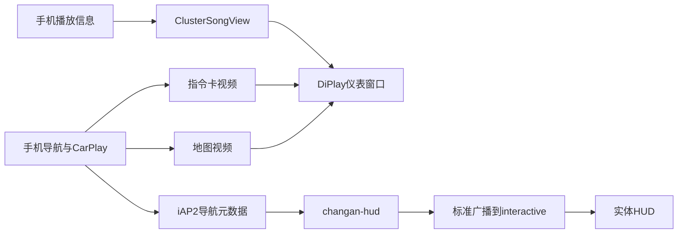

# CarPlay原生转向视频卡与长安HUD

## Apple公开说明

Apple在WWDC19《Advances in CarPlay Systems》3:21–5:28介绍了仪表多视频流：地图与转向提示卡可以作为独立视频并行输出；HUD继续使用iAP2 Route Guidance，Now Playing数据可由车端自行呈现。

官方原文：[WWDC19 session252](https://developer.apple.com/videos/play/wwdc2019/252/?time=201)。该演示明确以Apple Maps为例，不能改写成“所有第三方地图必然提供同样卡片”。

Apple的[WWDC25《Turbocharge your app for CarPlay》](https://developer.apple.com/videos/play/wwdc2025/216/)还说明导航应用可通过CarPlay框架提供仪表/HUD转向元数据。这支持区分视频画面与导航数据，不代表公开文档定义了本项目采用的所有接入细节。

## 本项目实际实现

“Apple完整导航”是本上游菜单的命名。`CarPlayClusterDisplay.Content.FLY_CARD`请求普通地图，并额外声明原生指令卡显示内容：

- 地图：`maps:/car/instrumentcluster/map`
- 卡片：`maps:/car/instrumentcluster/instructioncard`

这些具体URI是本项目配置和已观察协商路径，本文不把它们当作来自Apple公开文档的API保证。本项目内部用`SCREEN_TYPE_ALT_CARD=112`区分卡片流，也不将该编号写成Apple公开协议的固定常量。

手机端输出卡片像素，Host把对应Surface交给视频接收/解码，`ClusterMapPresentation`创建独立卡片窗口。因此卡片可与地图分别定位，它不是必须烘焙在地图视频中的同一块画面，也不是本地`ClusterTurnCardView`绘制。第三方地图是否实际提供，仍以手机输出及画面观察为准；本车原版测试收到了112流，用户随后看到仪表转向卡，但不是据此断言Apple Maps正在承担高德路线计算。

音乐卡是另一条链路：`CarPlayMediaKeys`/播放信息进入`setSong`和`setSongArtwork`，由本地`ClusterSongView`绘制，不是上述指令卡视频窗口。右侧短期油耗等原车仪表信息不属于这两个View，本次不改。

## 版本44重编译

0.2.22定制支线在版本43已接入独立`changan-hud`、自动全屏模块和内容选择修复。版本44按本轮要求重新构建并增加本说明，保留原生卡片路径；本次不宣称重新实现了一套已有HUD，也不加入未经验证的卡死修复。生产逻辑与43一致，版本更新为`0.2.22-ca75plus.2-hud-test`（44）。

长安HUD从iAP2导航元数据解析图标/距离/路名，向`com.incall.interactive`定向发送标准广播，不依赖识别卡片图像；“Apple完整导航”模式可与HUD并行。音乐和原生指令卡按上游路径保留，本地自绘导航卡片组仍只由自定义内容选择开启。

## 已知实车边界

2026-10-26旧维护线42在S311_MCA上验证了正常结束、后台保持、小屏触发约1.6秒全屏及卡片门控。原厂自动巡航开启时仍反复闪烁，补偿虽触发也不能阻止接收端先清零；用户关闭原厂自动巡航、退出巡航后稳定。43/44沿用同一补偿逻辑，不能标为该冲突已解决。

原版37测试有一轮长时间画面冻结/连接中断，车机运行时长和进程连续、未见ANR，用户观察到手机发热及Wi-Fi关闭。现有证据不能证明发热因果或原生卡片就是根因，停帧检测与清理时序仍待复查。本次重编译不改变该连接逻辑，也不修改原车油耗卡或手机网络。
