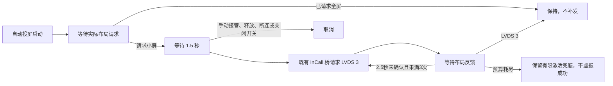

# 长安仪表自动全屏（0.2.22 / 版本43，待实车复验）

基于新版 `c83b33b`。长安投屏启动策略位于独立 `:changan-projection` 模块，仅依赖通用定制 API；HUD 模块不依赖它。首次默认开启“启动时自动切换仪表全屏”，开关始终显示，保存的关闭状态保留。

## 诊断依据

本车 S311_MCA 的系统 APK 明确区分：LVDS 1 为小屏、3 为全屏；扩展屏广播模式 1 为小屏、2 为全屏。Binder tx21 是滑动事件，参数 `[1,0]` 不代表小屏；tx1 的完成标志 0 经系统映射成属性值 1，也不是屏幕大小。

2026-10-25 实车日志：旧版在 18:09–18:10 已执行包含 `setMode(3)` 的启动/重申；但用户关闭 ADB 后，18:19:55 才收到 LVDS 小屏请求，18:20:22 手动切全屏时收到 LVDS 3。因此不能只把某个字面量 1 改成 3；此轮需要跟随实际请求的时序。

## 行为

不因显示设备已存在就断言实体仪表已投屏。策略只消费明确的 `onRequestLVDS` 回调，既有 `onIPNavigateStatus` 保持原含义。初次请求晚到（包括 ADB 关闭后才到达）也能进入策略，不只依赖启动后的固定秒数。

全屏补偿复用桥内原有 C0(3)+Z 路径，不重新执行导航源广播阶梯，不重建 CarPlay 流。版本 42 区分派发和确认：仅 LVDS 全屏反馈确认完成；无反馈时每 2500ms 再试，最多 3 次且只请求全屏。独立恢复期间暂停旧模式重申；预算耗尽后允许原有有限激活兜底，不虚报成功。确认后停止重试，后续手动小屏不再被持续拉回。

新版上游已移除高德进程探测与拉起器，不导入旧维护线的三态探测。通道watcher每500ms采样，等待真实横屏尺寸；通道未开时按5/15/30/60秒有限激活。通用`shouldActivateProjectionChannel()`在布局恢复尚未确认期间暂停源激活；确认全屏停止布局重试，但不会永久禁止后续关闭通道的恢复。跳过恢复期间不消耗watcher发送预算。重连已有全屏投屏时保留布局，不先发小屏。Controller重复会话开始不清空策略；取消日志记录原因。

若进程启动时通道已开，watcher调用`adoptObservedProjection`，仅在真实InCall状态确认且未归还屏幕时接纳通道，建立本地策略生命周期并重放缓存的真实布局事件；该接纳不发激活广播或Binder布局请求。单有display或旧布局缓存不能接纳。已接纳的通道不重复重置策略，小屏恢复仍按独立模块的延迟/开关执行。

可选 CarProperty 反射签名不存在时仅记录一次不可用，继续既有 InCall 路径，不反复打印异常栈，也不把方法缺失误报为权限问题。

会话结束、投屏释放、应用内手动切换和关闭设置会取消待发任务；旧会话的延迟任务不能作用于新会话。开启设置在下次自动投屏生效，不立即改变当前手动布局。关闭此设置保留原有投屏启动逻辑。

## 合并入口与验证

- API：`ProjectionLayout`/`ProjectionControl` 与注册表投屏事件、重试策略；不包含厂商编号。
- `CarPlayHostActivity`：标明自动启动、通知手动接管、检查是否继续原有模式重试。
- `InCallClusterBridge`：转发 LVDS 布局请求，提供既有协议派发入口，释放时通知模块。
- 模块：私有 provider 注册、独立偏好设置、纯策略状态机、主线程延迟与取消、异常隔离。
- `check_customization_integration.py` 及两项工作流：检查入口、模块测试与应用编译。

离线测试不能证明 MCU 接受全屏。`requestLayout` 的 true 只表示 Binder 请求已派发，不能作为实体全屏成功回执。新版本需驻车、关闭 ADB 后实测自动全屏及 HUD 共存；未测试前不声明自动全屏已通过。

版本39已确认HUD保持、退出清除、后台保持及仪表共存；版本40已确认能自动全屏，但存在等待问题。新版43以及旧线42的新恢复逻辑都需再次安装授权和独立复验。
