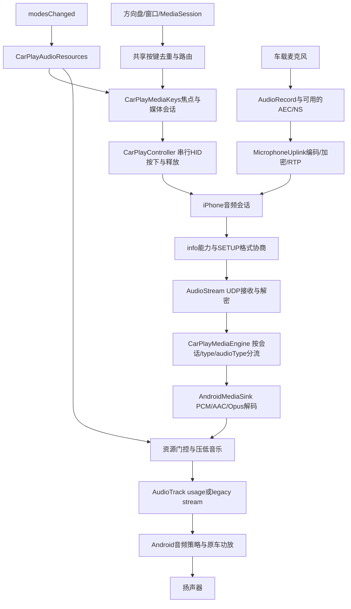

# 64候选：恢复圆角与CarPlay音频链路审计

2026-10-31。审计基线为维护分支的63版`77803bb`，64=`0.2.22-ca75plus.22`。本轮修改本地界面样式，音频生产逻辑保持原样；没有访问ADB、安装车机、推进暂停中的61吸收分支，也没有发布正式发行版。

结论：媒体音流和普通切歌的主要方向与Apple公开架构相符，但当前实现不能称为“完全按照Apple接收端规范”。已发现资源管理、Siri按键及本地增益处理的明确覆盖缺口，另有车机接口限制。下文区分源码事实、公开依据和待验证影响。

## 一、界面恢复范围

恢复62版已有的轻量圆角磨玻璃外观：面板28dp、主要按钮30dp，恢复选择项、提示徽标、图片预览、视频控制按钮、音乐封面与自绘卡片的原有圆角。配色、静态背景缓存、卡片默认关闭行为继续沿用；不增加实时模糊、动态折射或刷新线程。Apple的按钮指南提供圆角矩形、胶囊等形状建议；这里参考外观原则，不是Apple原生UI实现。[Apple按钮指南](https://developer.apple.com/design/human-interface-guidelines/buttons)

| 文件 | 本次作用 |
| --- | --- |
| `customizations/glass-ui/.../GlassUi.kt` | 恢复面板和按钮半径，继续使用现有静态材质 |
| `common/.../DiPlayActivity.kt` | 恢复首页、设置选项及徽标圆角 |
| `common/.../CarPlayHostActivity.kt` | 恢复设置面板和图片预览圆角；音频段落未修改 |
| `common/.../CarPlayVideoActivity.kt` | 恢复视频播放器的按钮外观，不修改CarPlay视频解码 |
| `common/.../GlassCardStyle.kt` | 恢复DiPlay自绘卡片的圆角绘制 |
| `common/.../ClusterSongView.kt` | 恢复音乐封面自身的圆角 |
| `common/src/main/res/drawable/widget_navigation_background.xml` | 恢复导航组件背景20dp圆角 |
| `common/.../GlassUiRenderTest.kt` | 根据新需求把63版的直角断言改为精确的28/30dp圆角断言，预览版本更新到64 |
| `mobile/build.gradle.kts` | 候选包版本64，不更新正式发行标签 |

63版的直接全屏与热点信息预填保留。CarPlay视频容器的矩形边界也保留，未重新加回本地视频裁剪遮罩。

## 二、CarPlay外边界：官方并非统一要求直角或圆角

Apple以矩形view area和其内部的矩形safe area描述显示几何；它们不等于每个视觉元素都必须是直角。[WWDC19显示区域说明](https://developer.apple.com/videos/play/wwdc2019/252/)

Apple明确展示了CarPlay圆角和corner clipping masks：iPhone提供角部透明度信息，接收端可将圆角后的黑色区域与原车背景混合。它不是任意裁去视频四角；视频在安全区外绘制时不能使用这类遮罩。Apple还要求接收端具备多音流混合能力，并介绍了main buffered audio等增强能力。[WWDC23系统集成说明](https://developer.apple.com/videos/play/wwdc2023/10150/)

本项目`AirPlayInfoPlist.kt:255`声明`drawUIOutsideSafeArea`；本次源码搜索没有找到corner mask协商、接收和应用实现。`CenterMapOverlay.kt:125`、`ClusterMapPresentation.kt:562`当前不做本地圆角裁剪。因此：

- DiPlay自有面板/按钮恢复圆角，是本地UI调整。
- CarPlay视频继续完整交给矩形容器，不用本地遮罩伪装官方corner mask支持。
- 视频内iPhone已经绘出的圆角属于远端内容，改Android背景不能无损改变它。
- “本车屏幕是长方形，所以Apple要求所有CarPlay画面必须直角”不是成立的前提。

## 三、音频和按键实际链路

注意三套不同概念：Apple的`mainAudio/alternateAudio`资源与音流、Android的usage/legacy stream编号、蓝牙的A2DP/HFP/AVRCP profile。设置中的媒体12、导航10属于Android/车厂路由选择，不是Apple规定的CarPlay声道号。

| 环节 | 当前源码锚点 | 实际行为和边界 |
| --- | --- | --- |
| 能力声明 | `AirPlayInfoPlist.kt:152` | 按type/audioType声明PCM、AAC、Opus及麦克风能力；不能用媒体键开关代替音频能力协商 |
| 流协商 | `AirPlaySession.kt:559`、`CarPlayMediaEngine.kt:121` | 接受100/101/102，按会话和audioType区分并行流；不会因选择蓝牙按键就拒收媒体音流 |
| 接收/时钟 | `AudioStream.kt:94,220`、`CarPlayMediaEngine.kt:303` | UDP接收、认证解密；PCM/AAC按格式选采样率，Opus解码48k并单独保留RTP时钟；反馈使用RTP时钟 |
| 解码/输出 | `AndroidMediaSink.kt:1575,1662,1769` | 每路独立解码和AudioTrack；媒体/导航分别可指定legacy stream，初始化失败回退usage路由 |
| 类型映射 | `AudioChannelMapping.kt:53` | telephony→PHONE，speechrecognition→ASSISTANT，media→MEDIA；default/alert被归到NAVIGATION，存在语义覆盖不足 |
| 输出归属 | `CarPlayHostActivity.kt:4686`、`CarPlayAudioResources.kt:16` | 收到有效mainAudio归属后更新媒体输出许可；不把Android焦点或歌曲元数据当作手机实际输出路由证明 |
| 焦点 | `CarPlayMediaKeys.kt:212,235`、`AndroidMediaSink.kt:136,651` | 媒体由MediaSession侧管理；重复归属与歌曲元数据不重抢焦点；导航另有短暂MAY_DUCK焦点 |
| 混音/增益 | `AndroidMediaSink.kt:170,235,2075` | 多Track混音，压低音乐有期限并可恢复；当前同时使用音轨音量与PCM缩放 |
| 音量键 | `CarPlayHostActivity.kt:1916` | 导航实际写入PCM的时间窗中优先调整导航流；其余交给系统。不是完整的每音频类别音量仲裁 |
| 麦克风 | `CarPlayMediaEngine.kt:391`、`MicrophoneUplink.kt:42,204` | 匹配主流的telephony/speechrecognition才启用采集，使用协商采样率、可用AEC/NS，编码并加密回传 |
| 通话模式 | `AndroidMediaSink.kt:683,724,764` | telephony设置通信模式，采集结束恢复；另有音乐音量快照/恢复兼容逻辑 |
| 普通媒体键 | `CarPlayHostActivity.kt:1902`、`CarPlayMediaKeys.kt:331,483` | 窗口和MediaSession汇入路由，通话期间拦截条件，250ms应用内去重；外部模式无延迟CarPlay补发 |
| CarPlay发送 | `CarPlayController.kt:508`、`AirPlaySession.kt:230` | 会话身份校验、串行发送媒体HID非零报告及零报告，表示一次按下和释放；排队成功不等于手机执行确认 |
| 蓝牙交接 | `WirelessAudioHandoffGate.kt`、`TargetBluetoothHandoff.kt` | 当前会话收到关闭蓝牙请求、认证隧道就绪、引导连接已释放后，处理选定手机的profiles；不调用全局disconnectAll |
| 清理 | `AirPlaySession.kt:130`、`CarPlayMediaEngine.kt:335,351`、`AndroidMediaSink.kt:940` | 显式TEARDOWN与整机sink.close有清理；单会话异常关闭的回调存在缺口，见下文 |

公开资料将主音频归属、临时借用与归还、导航混入、按当前声音类别调音量分别处理；Android音频焦点不是这些协议状态的替代品。[WWDC16 Part 2](https://developer.apple.com/videos/play/wwdc2016/723/)

## 四、检查结果：哪些已经一致，哪些仍有缺口

### 方向正确的部分

- 音乐经CarPlay音流播放，媒体键经CarPlay发送，未采用“蓝牙发送一次再超时补CarPlay一次”的混合策略。
- 窗口和媒体会话共享应用内去重；媒体元数据不再作为自动重抢焦点或补发切歌的证据。
- 每次恢复请求绑定控制器代次和手机会话；用户明确暂停取消旧的播放准备。恢复失败不会循环自动PLAY。
- 媒体失去协议归属后静音媒体并释放其焦点，导航仍可混入。相同归属的重复通知不重抢焦点。
- 同一手机的蓝牙交接在无线会话条件满足后触发。Apple公开无线流程也要求收到手机的关闭蓝牙命令后断开该手机的蓝牙连接；这不是要求用AVRCP承担CarPlay切歌。[WWDC17无线CarPlay](https://developer.apple.com/videos/play/wwdc2017/717/)

### 需要修正或补全的部分

| 优先级 | 已确认的源码事实 | 影响判断与建议 |
| --- | --- | --- |
| 高 | `CarPlayAudioResources`的UNKNOWN允许媒体；主资源门控只覆盖MEDIA；原车焦点变更没有对应的完整take/borrow/unborrow状态机 | 目前是部分资源管理，不是完整原车/CarPlay资源仲裁。不能把收到一次PHONE归属等同于所有声音路由正确；后续应先明确资源类型与车机事件，再实现状态机，不猜协议数值 |
| 高 | `CarPlayHostActivity.kt:1974`只在Siri键ACTION_UP请求；`AirPlaySession.kt:240`随即合成两条requestSiri命令 | 没有保留物理按下/抬起时间，不能证明按住说话/释放行为符合公开要求。Apple明确要求Siri按钮上/下事件送到手机；需核实本车实际键事件，再接真实边沿。[WWDC16 Part 1](https://developer.apple.com/videos/play/wwdc2016/722/) |
| 高 | `setStereoVolume(gain)`与`applyMediaGain()`同时作用于媒体PCM | 在正常执行音轨增益的ROM，配置75%可能产生0.75×0.75≈56%的振幅，而不是75%；固定音轨音量的ROM仅PCM有效。是确定的条件性重复衰减，不证明当前“平时也偏轻”一定由此造成。建议压低只保留一处确定增益，并单独验证 |
| 高 | `CarPlayMediaEngine.onSessionClosed()`关闭网络流但没有逐路调用sink的audio/microphone stopped；Host在设置菜单打开时可能不立即整栈重连 | 显式TEARDOWN路径有清理，整栈关闭也有清理；但异常断连到重建之间，旧Track/麦克风清理没有同等保证。应补全会话关闭的逐流收尾与幂等测试 |
| 中 | `onAudioStopped()`对任何非媒体流都resetPlaybackVolume；麦克风停止也清空全部duck原因 | 重叠播报/语音中，一路结束可能提早取消仍有效的另一压低原因。应按存活音流和原因计数恢复，而不是无条件“回满” |
| 中 | default、alert与真正alternate/navigation未完整按type+audioType区分；映射仅把它们都当导航 | 铃声或默认主流可能使用导航音量/焦点，主资源许可也未覆盖这些类型。需要明确传输类型和语义后映射，不能只改12/10解决 |
| 中 | `CarPlayMediaKeys`直接申请媒体焦点；导航焦点也独立于现有“音频焦点”开关 | 设置说明不完整，关闭开关不意味着停止所有焦点申请。应统一开关含义及管理入口，保留已验证的防重复重抢行为 |
| 中 | 音量恢复只判断当前低于快照，没有区分用户主动调低；部分结束路径忽略快照TTL | 用户通话中手动调低也可能被恢复到旧值。快照又固定使用STREAM_MUSIC，不一定代表媒体12的实际功放总线；需区分用户操作和系统压低 |
| 中 | 按键去重只涵盖DiPlay入口；原车独立AVRCP不经过该路由。交接会遇到隐藏接口/权限拒绝，通话状态不明会推迟 | 应保留当前单出口和有界重试，不能保证所有车况绝不双切。profile断开也不等于已验证手机扬声器最终路由 |
| 低 | 未识别audioFormat退回44.1k双声道PCM；部分音频诊断回调异常未隔离 | 未知格式可能误解码；异常日志回调可能使初始化失败。应显式拒绝/诊断未知格式，并隔离可选日志异常，测试已暴露后者 |

上述增益、快照及状态机是本项目源码分析，不是Apple文档为Android指定的实现方案。不能因为12/10、采样率或“有声音”就推导音量、优先级、路由均正确。普通静音状态下gain为1，重复增益本身不会恒定降低所有声音；需要下次用同一音源、同一音量标尺采集验证。

### 能力范围与认证边界

当前100/101/102接收和按需麦克风不等于已实现增强缓冲、auxiliary音频、持续ECNR/关键词检测与历史麦克风缓冲。它们属于后续能力，不应作为本次低性能Android车机的隐含新增要求。现有AEC/NS是否可用还取决于ROM，不能凭创建API就认定通话回声质量达标。

Apple的完整接收端技术规范和认证工具通过MFi提供；公开的iPhone CarPlay App模板文档不能替代接收端协议验证。本次结论只能是公开架构对照与本地源码审计，不能写“完全符合Apple规范”或“已通过CarPlay认证”。[Apple MFi流程](https://mfi.apple.com/en/how-it-works.html)

## 五、本轮验证与下一步边界

64定向测试共196项：192通过，4失败，0错误/跳过。独立长安音频模块20项、common的UI/按键/媒体焦点等63项全部通过；shared扩展音频测试113项中4项失败。4个失败名称均在原始`c83b33b`基线记录中存在：

1. `AndroidMediaSinkStateTest.recreatingTheScreenRestoresItsActiveVideoState`：普通JUnit未模拟MainLooper。
2. `MicrophoneCaptureStatsTest.aggregatesFiveSecondWindowsAndKeepsFinalPartialWindow`：原断言失败。
3. `TelephonyMicrophoneTest.diagnosticCallbackFailureDoesNotStopCallCaptureOrChangeModeRestoration`：初始化诊断回调异常外溢。
4. `TelephonyMicrophoneTest.diagnosticCallbackFailureDoesNotStopSpeechRecognitionCapture`：同类异常外溢。

失败XML和日志已保留；没有删除、跳过、降低断言，也没有把更小的通过集合冒充全量通过。本轮因扩大审计范围而检出原有问题，音频源代码未因圆角恢复改变。初次shared测试失败后，另行完成原计划的common测试、APK构建和lint，未反复重跑同一失败。

`assembleStandaloneDebug`成功；lint为0错误、19警告。1280/1920两种宽度的10张真实Android布局预览已生成，首页及设置页完成目视复核。64白名单签名、包名、运行资产、版本、编译桩隔离与16KiB对齐核验通过；本次未做实车验收。

建议音频修复另起一个小范围提交：先处理单点增益、流关闭清理与重叠duck；再处理资源仲裁、Siri真实边沿和音量恢复。保持普通切歌、微信语音恢复及同会话防串线的现有回归，避免与界面、上游吸收和投屏策略同时大改。
